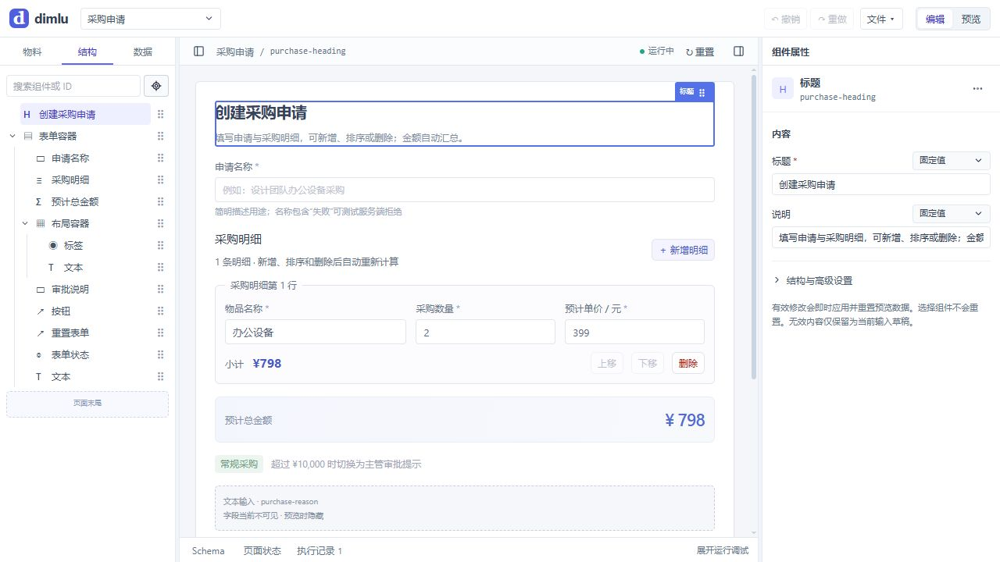
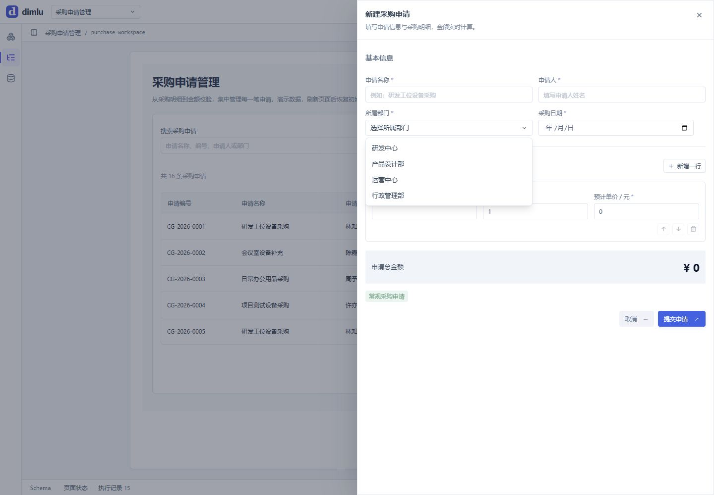
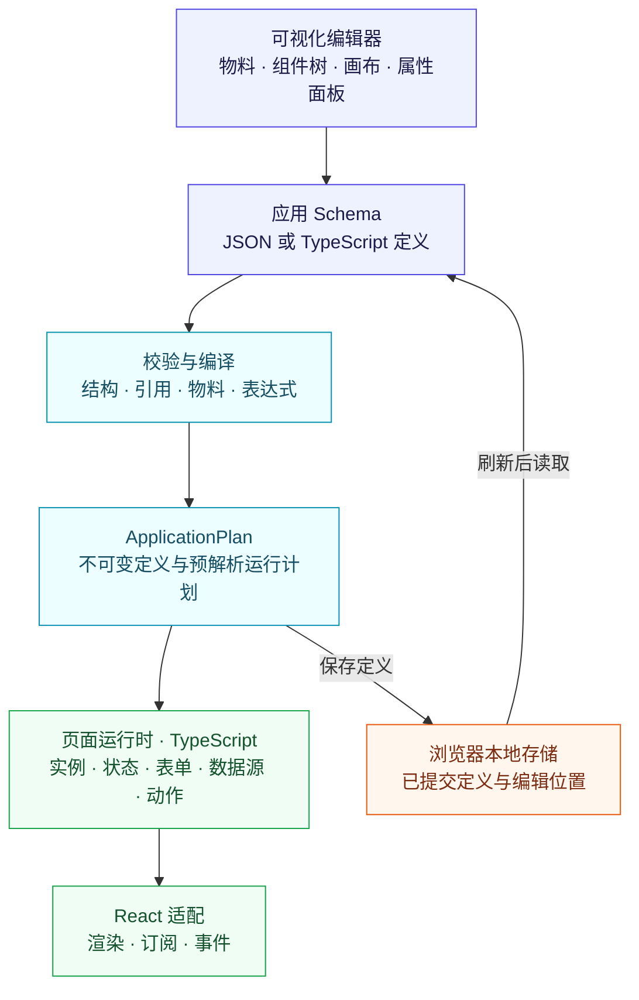
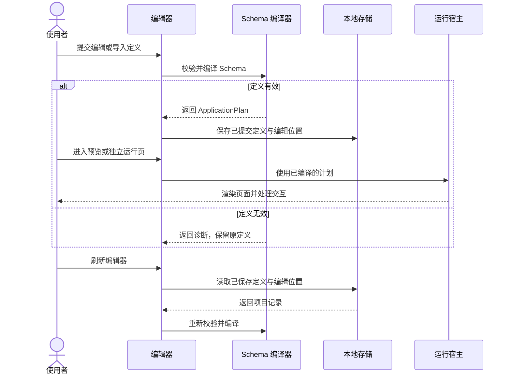

<div align="center">

# Dimlu

### 本地优先的 React 低代码应用搭建器

从可视化编辑到运行时预览，以 Schema 驱动页面、表单和交互。

[快速开始](#快速开始) · [界面预览](#界面预览) · [架构概览](#架构概览) · [设计文档](#设计文档)

</div>

## 界面预览

**可视化工作台**：左侧是组件树，中间是页面画布，右侧是选中组件的属性面板。



**采购申请示例**：在列表中打开新建抽屉，填写申请、增删采购明细，系统自动合计金额。



> 项目处于原型和持续演进阶段，适合学习低代码运行时设计、验证交互方案和开发内部工具原型，不定位为开箱即用的生产级 SaaS。

## 主要能力

- 多应用目录：创建、复制、切换和删除本地应用。
- 可视化编辑器：组件物料、组件树、画布选择、拖放编排、复制、删除、撤销和重做。
- Schema 驱动：应用和页面定义可导出为 JSON，并在导入时进行结构与语义校验。
- 独立运行时：运行时不依赖 React，负责运行计划、页面实例、状态、表单、生命周期和动作链。
- React 适配：使用 React 渲染组件，并通过订阅机制更新节点所需的数据。
- 表单能力：字段模型、字段绑定、校验、提交、重置和动态明细。
- 页面逻辑：条件渲染、循环渲染、事件与动作、数据源和页面状态。
- 页面代码：支持在编辑器中编写 JSX/TSX 与页面 CSS，并在预览或运行模式中执行。
- 运行模式：编辑、预览和独立运行页之间可以切换，运行页支持按页面导航。
- 本地持久化：应用定义和编辑状态保存到当前浏览器，刷新后恢复；运行时数据和未提交草稿不会作为项目定义保存。
- 默认示例：内置“采购申请管理”示例，用于验证表单、动态明细、金额派生和提交流程。

## 快速开始

### 环境要求

- Node.js 22.18 或更高版本
- npm

### 安装并启动

```bash
npm install
npm run dev
```

启动后打开终端输出的本地地址。应用默认进入低代码编辑工作台。

### 常用命令

```bash
# 启动开发服务器
npm run dev

# 运行全部测试
npm test

# 类型检查并构建生产文件
npm run build

# 导出公开 Schema 和示例文件
npm run schema:export

# 检查格式
npm run format:check

# 自动格式化
npm run format

# 预览生产构建
npm run preview
```

Windows PowerShell 用户也可以将 `npm` 替换为 `npm.cmd`。

## 使用方式

### 创建应用

1. 打开应用目录。
2. 选择“新建空白应用”。
3. 在左侧物料面板选择组件并拖入画布。
4. 在组件树或画布中选择节点，在右侧面板编辑属性、样式、逻辑和绑定。
5. 使用顶部的保存、预览和运行入口验证应用。

应用定义会按应用 ID 独立保存。浏览器刷新后，已保存的应用仍可从应用目录恢复。保存失败时，当前内存中的内容和导出入口会保留，不会继续执行依赖保存成功的切换或删除操作。

### 编辑、预览与运行

- **编辑模式**：修改 Schema、组件属性、页面样式和页面代码。
- **预览模式**：以运行时方式查看页面交互，但保留在编辑工作台中。
- **运行模式**：进入独立运行地址，按应用入口页加载页面，可通过“编辑应用”返回工作台。

独立运行地址的形式为：

```text
/apps/<applicationId>
```

### 导入示例

仓库提供两个公开示例：

- `public/examples/starter.json`：最小页面示例。
- `public/examples/purchase-management.json`：采购申请管理示例。

可以通过编辑器的文件菜单导入 JSON。导入内容会先经过 Schema 和语义校验；无效定义不会替换当前应用。

## 架构概览

Dimlu 把“可编辑的定义”和“可执行的页面实例”分开：编辑器修改 Schema，运行时先校验并编译成运行计划，再创建独立的页面实例。React 只负责渲染和订阅，不承载核心业务状态。



### 从编辑到运行



核心包与应用目录：

- `packages/schema`：应用 Schema、JSON Schema、类型和语义校验。
- `packages/runtime`：表达式、运行计划、页面实例、表单、动作和数据源运行时。
- `packages/react-runtime`：React 渲染器和运行时订阅 Hook。
- `packages/editor`：文档模型、编辑命令、撤销历史、校验和项目存储。
- `src/editor`：编辑器界面、物料面板、组件树、画布、属性面板和导入导出。
- `src/materials`：内置 React 物料及其编辑元数据。
- `src/code`：页面 JSX/TSX 编译、代码草稿和页面代码运行。
- `src/ui`：基础控件、Monaco 编辑器和本地 Worker。
- `src/App.tsx`：应用目录、编辑器路由和运行页宿主。

## 设计文档

- [架构与设计决策](docs/architecture.md)
- [Schema v0.1](docs/schema-v0.1.md)
- [应用与页面模型](docs/application-page-model.md)
- [编辑器基础](docs/editor-v0.1.md)
- [编辑器交互](docs/editor-interactions.md)
- [页面 React/CSS 代码](docs/page-code.md)
- [本地项目保存与恢复](docs/project-storage-v0.1.md)

## 扩展组件和动作

### 注册 React 物料

扩展一个组件通常需要完成两部分：

1. 在运行时注册表声明组件 ID、版本、属性、事件和插槽。
2. 在 React 物料目录中注册实际的 TSX 组件和编辑器配置。

组件可以使用普通 React props、事件和 Hooks。编辑器配置只服务于编辑阶段，运行时不会依赖编辑器界面。

### 使用 Schema 表达式

Schema 支持受约束的 JavaScript 表达式子集，例如：

```text
forms.purchase.computed.total > 10000
state.filters.keyword
scope.person.name
```

它不是完整的 JavaScript 执行环境。需要闭包、复杂语句或 React Hooks 时，应使用注册的 TypeScript 组件、动作或页面 TSX 代码。

### 页面代码的边界

页面代码支持 JSX/TSX 和页面 CSS，但当前仍属于原型能力：

- 页面代码在当前浏览器窗口中运行，不是安全沙箱。
- 页面代码具备浏览器环境可访问的能力，不应执行不可信代码。
- Monaco 提供编辑体验，但不会替代运行时 Schema 和协议校验。
- 页面 CSS 按页面作用域安装，避免影响其他页面和编辑器外壳。

## 数据和安全边界

Dimlu 默认不需要后端、账号或外部服务，应用定义保存在浏览器本地存储中。仓库中的数据源和采购案例使用本地模拟能力，不代表已经接入真实业务后端。

请注意：

- 不要将真实用户数据、密钥、令牌或敏感业务数据直接放入示例和页面代码。
- 导入的页面代码只应来自可信来源。
- 当前项目没有内置用户认证、权限系统、协同编辑、服务端数据库或多租户隔离。
- 清理浏览器站点数据会删除当前浏览器中的本地项目；重要定义应先导出 JSON 备份。

## 测试与质量检查

测试使用 Vitest、jsdom 和 Testing Library，覆盖 Schema 校验、运行时隔离、表单、动作链、数据源、编辑器命令、拖放意图和页面路由等行为。

提交前建议执行：

```bash
npm test
npm run build
npm run format:check
```

如果修改了 Schema 或公开示例，还应执行：

```bash
npm run schema:export
```

## 项目状态与后续方向

当前优先保证核心链路稳定：

- 应用创建、编辑、保存、预览、运行和刷新恢复。
- Schema 校验与运行时执行语义。
- 组件、表单、动作和数据源的基础闭环。
- 编辑器在不同应用之间的隔离和导航一致性。

仍然需要独立设计或继续完善的方向包括：

- 真实后端数据源、认证、权限和多租户。
- 远程物料包、版本锁定、签名和沙箱执行。
- 更完整的 Schema 类型系统和嵌套数据模型。
- 协同编辑、发布管理和生产环境部署流程。
- 页面代码的更严格安全隔离。

## 贡献

欢迎通过 Issue 或 Pull Request 讨论问题、补充测试和提交实现。提交代码前请确保：

1. 新行为有对应测试。
2. `npm test`、`npm run build` 和相关格式检查通过。
3. 修改 Schema 或示例时同步更新对应文档。
4. 不提交本地构建产物、浏览器缓存、密钥或真实业务数据。

## 许可证

当前仓库未包含 `LICENSE` 文件。若要在开源分发时明确授予他人使用、修改和再分发的权利，请在发布前补充合适的开源许可证。
