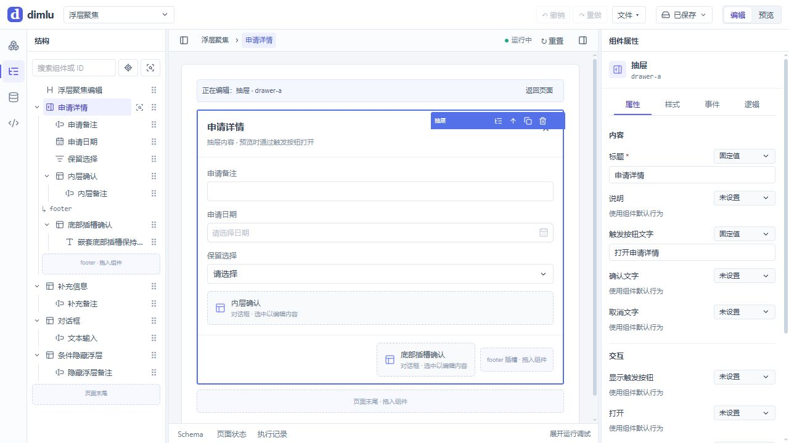

# 面板与画布交互

编辑器保持 React + Base UI + Tailwind。面板、悬停、定位和设计期浮层范围都是编辑会话状态，不进入应用 Schema。

上图为独立验收案例；默认采购项目及已有本地项目不被替换。

## 选择、悬停与定位

组件树、画布和顶部层级路径共享悬停提示。悬停不改变选区、不写撤销历史，也不滚动页面。普通树选择仅切换属性检查对象；离屏组件通过结构面板的“在画布定位”显式滚入画布。

画布选中工具条的“在组件树定位”会打开结构面板、清除搜索、展开祖先并定位对应行。只有面板或画布的内容区域滚动，外壳保持全高。顶部层级路径可以选择页面或祖先组件。

显示条件未满足、字段不可见或循环数据为空时，定位会说明原因，必要时定位可见祖先；选区仍保留原节点，不修改业务条件来强行渲染。重复组件的结构树表示定义，画布记录具体实例；工具条只在一个实际可见实例显示。

拖动手势开始后，包括尚未达到移动阈值的阶段，定位入口暂时禁用。取消或结束拖动不会补执行之前的定位。画布顶部和内部滚动容器会参与工具条裁剪计算。

## Dialog 与 Drawer 的设计期范围

普通画布中，Dialog、Drawer 显示紧凑占位。选择浮层自身或其可达后代后，画布进入该浮层的编辑范围，顶部显示“正在编辑”与“返回页面”。选择页面或普通页面组件也会返回页面范围。

嵌套浮层只展开当前目标，必要的浮层祖先保留上下文并隐藏外观和其他分支。重复定义只展开一个实例；从画布选择时保留实际实例，从树选择时确定一个可编辑实例。条件未满足的浮层不被强制打开。

聚焦只改变设计展示，不调用业务打开、关闭或确认操作，不重建运行实例，不迁移 React 子树。已有表单值、明细行、Hook 状态及 Portal 宿主保持。拖动期间编辑范围保持不变，“返回页面”暂时禁用。

预览恢复业务的打开状态、遮罩、焦点与 Escape 行为。设计期选中浮层，不表示预览时会自动打开它；预览仍通过页面按钮或事件操作打开。

## 面板与扩展边界

物料、结构、数据、代码使用同一静态面板描述表，统一标题、图标、宽度、激活入口和渲染。数据及代码面板首次访问才初始化，访问后保持挂载，切到结构定位不会丢失未应用草稿。

新增面板需要修改 `src/editor/panel-routes.ts` 和 `src/editor/panels.tsx` 的类型及描述；这是本地 TypeScript 扩展点。运行时渲染器可通过可选 `designPresentation` 与 `useMaterialPresentation` 接收宿主展示策略，业务组件无需读取编辑器会话。

当前未提供任意停靠、远程插件注册、多选、缩放或 iframe 画布。`CanvasHost` 先统一实例选择、可见区域和局部滚动，为后续视口能力提供基础。
